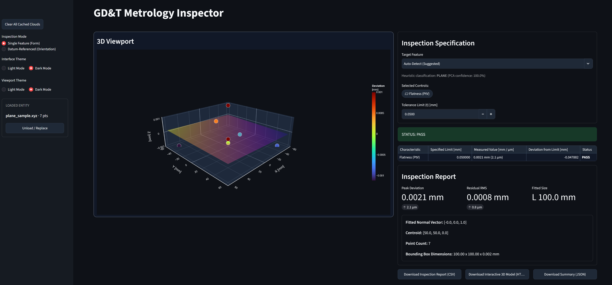

# pointcloud-gdt-evaluator

> High-precision Python engine for ISO 1101 / ASME Y14.5 GD&T evaluation and 3D point cloud feature fitting with an interactive CAQ inspection dashboard.

[](#installation)
[](#gd-t-conformance-matrix-iso-1101)
[](#quality-assurance-verification)
[](#quality-assurance-verification)
[](#key-architectural-features)

## 1. Overview & Problem Statement

`pointcloud-gdt-evaluator` is a lightweight, inspectable alternative for numerical point-cloud evaluation workflows that might otherwise depend on large, closed CAQ packages. It analyzes raw XYZ coordinates captured by laser scanners, coordinate measuring machines (CMMs), and articulated-arm CMMs (AACMMs).



The Python engine fits associated geometric features, calculates selected form and datum-referenced deviations, and presents results in an interactive inspection dashboard. NumPy and SciPy provide the numerical computations; sample reference datasets are included under `data/nist/`.

The project implements calculations for selected characteristics associated with ISO 1101 and ASME Y14.5 terminology. It is an engineering evaluation tool, not a standards certification or a claim that every rule, modifier, datum simulator, or inspection strategy in either standard is implemented. Results depend on sampling, feature coverage, measurement uncertainty, and the selected fitting/evaluation method.

## 2. Supported Geometries & Mathematical Fitting

| Associated feature | Fitting method | Residuals and derived measurements |
| --- | --- | --- |
| **Plane** | Orthogonal least squares using SVD on the centered point matrix (equivalent to the smallest covariance eigenvector). | Signed orthogonal distances; peak-to-valley flatness (⏥). |
| **Line 3D** | Principal component analysis; the first right singular vector is the fitted axis direction. | Point-to-axis distances; straightness (⏤). |
| **Cylinder** | Non-linear radial least squares using SciPy `scipy.optimize.least_squares` (trust-region reflective solver). | Radial residuals, fitted radius, and extracted axis; cylindricity (⌭). |
| **Sphere** | Algebraic linear least-squares sphere fit. | Radial residuals and peak-to-valley sphericity (S○). |

The fitting functions are in `src/gdt_engine/fitting/`. Plane and line fitting are orthogonal least-squares fits; the sphere fit is algebraic and is not an orthogonal nonlinear refinement.

## 3. GD&T Conformance Matrix (ISO 1101)

The numerical tolerance evaluators are in `src/gdt_engine/tolerances/`.

**Form tolerances (single feature):**

- Flatness (⏥), evaluated as the peak-to-valley spread of signed distances from an SVD fitted plane.
- Straightness (⏤), evaluated from point-to-axis distances for a fitted 3D line.
- Cylindricity (⌭), evaluated as the peak-to-valley spread of radial residuals from the fitted cylinder.
- Sphericity (S○), evaluated as the peak-to-valley spread of radial residuals from the algebraically fitted sphere.
- Circularity, available as a 2D section evaluator in the numerical API.

**Orientation tolerances (datum-referenced):**

- Perpendicularity (⟂): projected linear deviation over the specified reference extent `L`.
- Parallelism (//): angular divergence projected across the specified extent `L`.
- Coaxiality (◎): radial axis-to-axis deviation evaluated over `L`.
- Angularity is available in the numerical API for a specified nominal angle. The dashboard currently presents perpendicularity, parallelism, and coaxiality in its datum-referenced workflow.

These evaluators use the methods implemented by this project and do not replace a full standards interpretation, measurement plan, or uncertainty analysis.

## 4. Key Architectural Features

- **PCA-based auto-detection:** Heuristic classification of an unorganized point cloud using covariance eigenvalue proportions and, for less obvious shapes, sphere-versus-cylinder radial fit residuals. It suggests plane, line, cylinder, or sphere; it is a recommendation, not a guaranteed classification.
- **Persistent session state:** The Streamlit dashboard has Single Feature (Form) and Datum-Referenced (Orientation) modes. Parsed coordinate arrays and uploaded filenames are cached in the session so switching modes retains each mode's loaded clouds.
- **Interactive 3D viewport:** Plotly renders the points and fitted primitive in an interactive browser viewport. The dashboard supports adaptive, light, and dark viewport themes, centered coordinates, and aspect-corrected scene framing. WebGL rendering is provided by the browser/Plotly stack; it does not require a separate desktop viewer.
- **CAQ-oriented exports:**
  - CSV report with point coordinates, residual deviations, tolerance flags, and inspection summary fields.
  - Interactive 3D HTML model for review. The current export references Plotly.js from a CDN, so it requires network access to load the plotting library.
  - JSON summary for downstream SPC/CAQ integrations.
- **Command-line inspection:** `gdt inspect` currently supports plane and sphere fits. The four-feature selection and datum-referenced controls are available in the dashboard.

## 5. Directory Structure

```text
pointcloud-gdt-evaluator/
├── src/
│   └── gdt_engine/
│       ├── app.py
│       ├── diagnostics.py
│       ├── fitting/
│       │   ├── plane.py
│       │   ├── line.py
│       │   ├── cylinder.py
│       │   └── sphere.py
│       └── tolerances/
│           ├── form.py
│           └── orientation.py
├── tests/
├── data/
│   └── nist/
├── pyproject.toml
└── README.md
```

## 6. Installation & Quickstart

```bash
# Clone repository
git clone https://github.com/SCPK1/pointcloud-gdt-evaluator.git
cd pointcloud-gdt-evaluator

# Create and activate a virtual environment
python -m venv .venv
source .venv/bin/activate  # Windows PowerShell: .venv\Scripts\Activate.ps1

# Install the package and its runtime dependencies
pip install -e .

# Launch the CAQ inspection dashboard
streamlit run src/gdt_engine/app.py
```

Upload a `.xyz` or CSV-like text file containing exactly three finite numeric columns (`X Y Z`, comma-separated, semicolon-separated, or whitespace-separated). The parser accepts at least three points; individual fitters may require more points or non-degenerate geometry.

To run a command-line fit (plane and sphere are currently supported):

```bash
gdt inspect data/nist/plane_sample.xyz --type plane
gdt inspect data/nist/sphere_sample.xyz --type sphere
```

## 7. Quality Assurance & Verification

Numerical behavior is checked with pytest, including reference samples in `data/nist/`. Tests cover fitting, tolerance evaluation, parsing, exports, and dashboard behavior. The NIST samples provide regression references, not formal standards certification.

Run the test suite and static checks from the repository root:

```bash
pip install -e ".[dev]"
pytest -v
ruff check .
```

The project includes `pytest-cov` for generating coverage reports, but no coverage percentage is published by this repository. The Shields.io badges above describe project tooling and capabilities; they are not live CI status checks.
